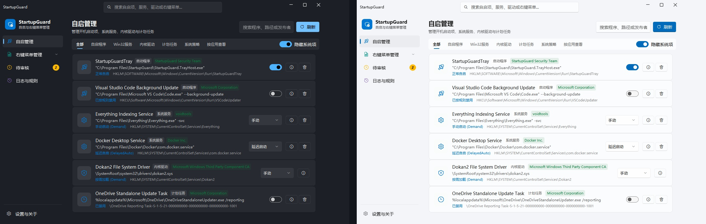
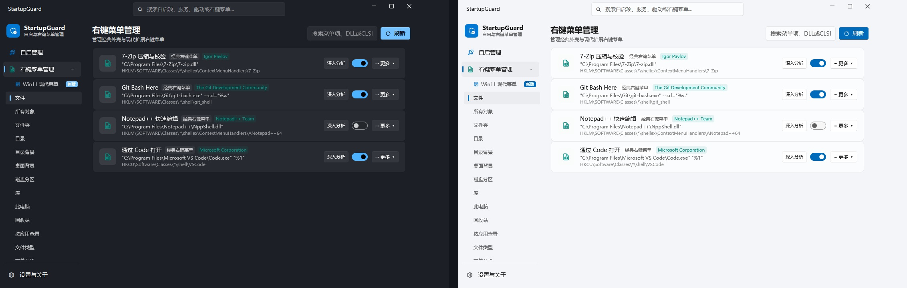
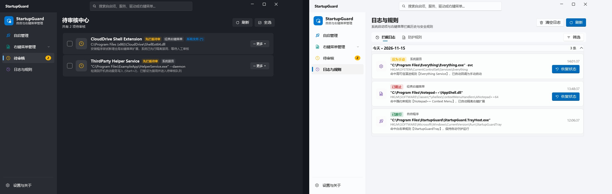

<div align="center">

# StartupGuard

**Windows 10 / 11 原生系统自启项、服务、驱动与右键菜单安全守护工具**

[](LICENSE)
[](https://dotnet.microsoft.com/)
[](https://www.microsoft.com/windows)
[](https://github.com/lepoco/wpfui)
[](https://github.com/PhoebeCLS/StartupGuard/releases)

先拦截后审核 · 全景自启与服务管控 · 经典与 Win11 现代右键菜单治理 · 演进规则匹配 · 深浅双模 Mica 原生体验

</div>

---

## 🎯 核心定位与理念

安装第三方软件、驱动或便携包时，最让人头疼的往往不是软件本体，而是它趁你不备写入系统的**开机自启程序、后台自动服务、计划任务、系统策略以及铺满屏幕的右键扩展菜单**。

`StartupGuard` 不止是一个“事后开关管理面板”，而是围绕 **「主动拦截 + 先抑后审 + 历史规则自演化」** 构建的四进程协作防护体系：

- **先拦截，后人工审核**：当后台守护服务捕获到新增自启项、自动服务、驱动或右键菜单写入时，先将可安全干预项即时隔离/禁用并推入托盘通知与「待审核中心」，把决定权彻底交还给用户。
- **全景自启管理**：覆盖启动程序（Run / RunOnce / Startup 文件夹 / UWP StartupTask）、Win32 系统服务（支持自动 / 延迟自启 / 手动 / 禁止）、内核驱动（仅安全切换状态，禁止误删 `.sys`）、计划任务、系统策略（IFEO / Shell / Userinit / 策略等）及**按应用智能聚合视图**。
- **经典 + Win11 现代右键菜单治理**：全面管理传统 `shell` / `shellex`、`SendTo`、`OpenWith`、新建菜单、**Win+X 系统快捷分组**以及 Windows 11 `PackagedCom` 现代右键菜单；支持**独立进程 `ProbeHost` 隔离探测**未知 Shell 扩展子菜单并可视化呈现。
- **六维可信度 + MD5 + 灰区差异弹窗**：支持单版本严格 MD5 匹配与跨版本永久自适应匹配；当软件升级导致路径变化、版本号更新或签名丢失时，自动弹出直观的新旧版本差异对比，有效防范“白加黑”与伪装劫持。
- **深浅双模与高效率工具栏**：遵循 Windows 11 Fluent / Mica 原生规范，支持实时全局搜索（点击触发紧凑展开并随滚动平滑扩宽）、游戏全屏防打扰、托盘自启与服务状态可视化管理及一键 AI 分析提示词生成。

---

## 🖥️ 界面实景展示（深浅双模自动对比）

> 以下截图由 GitHub Actions 在每次发版构建阶段通过 `--screenshot` 自动渲染更新。

### 1. 全景自启与服务/驱动/任务管理（按类别 & 按应用视角）

<div align="center">
  
</div>

### 2. 经典右键菜单与 Windows 11 现代菜单管理（含 Shell 扩展深入分析）

<div align="center">
  
</div>

### 3. 待审核拦截中心 & 拦截日志与规则记忆

<div align="center">
  
</div>

---

## 🏗️ 四进程协作架构

项目在 `.NET 10` 下采用低耦合、职责分离的四进程架构，以 `MemoryMappedFile`（高频规则库零拷贝读取）+ `SQLite`（本地持久化日志与规则）+ `Named Pipe IPC`（实时状态控制）协作运行：

| 组件 | 运行身份与职责 |
| :--- | :--- |
| **`StartupGuard.App`** | WPF / Fluent UI 交互主窗口，负责全景查看、待审核处置、规则管理、Win+X 排序编辑与全局搜索。 |
| **`StartupGuard.Service`** | `LocalSystem` 后台守护服务，负责内核 ETW / 注册表与任务目录变更捕获、对比基准快照、先拦截隔离及匹配历史规则。 |
| **`StartupGuard.TrayHost`** | 用户桌面会话托盘宿主，负责托盘快捷分类监控开关、Toast 审核提醒与多版本灰区对比弹窗交互。 |
| **`StartupGuard.ProbeHost`** | 独立短生命周期沙箱探测进程，用于按需隔离加载第三方 `IContextMenu` COM 组件读取子菜单结构，避免损坏主进程稳定性。 |

---

## 📦 下载与安装

前往 **[GitHub Releases](https://github.com/PhoebeCLS/StartupGuard/releases)** 根据设备架构（`x64` / `arm64`）与部署方式下载对应包（已取消 MSIX 发行，统一提供无限制且支持彻底卸载的原生版本）：

1. **安装版（推荐）**：`StartupGuard-X.Y.Z-<arch>-<self-contained|framework-dependent>-Setup.exe`
   - 自动安装程序组件、注册 `LocalSystem` 后台守护服务与托盘开机自启、支持快捷方式；卸载时默认保留个人规则库与日志，也可在卸载向导勾选“同时删除全部个人数据”以零残留清理程序、服务、注册表、`%LocalAppData%`、`%AppData%` 及 `C:\ProgramData\StartupGuard` 文件夹。
2. **绿色便携压缩包**：`StartupGuard-X.Y.Z-<arch>-<self-contained|framework-dependent>-portable.zip`
   - 解压至任意目录运行 `StartupGuard.App.exe` 即可使用，并在界面中按需注册或切换后台守护服务状态。
3. **部署变体选择建议**：
   - `self-contained`（独立自包含）：内置 .NET 10 运行时，开箱即用。
   - `framework-dependent`（依赖框架）：安装包体积更小，需系统已安装 [.NET 10 Desktop Runtime](https://dotnet.microsoft.com/download/dotnet/10.0)。

> **运行要求**：Windows 10 (19041+) / Windows 11 64 位（`x64` / `ARM64`；因内核 ETW 跟踪仅支持 64 位，暂不支持 32 位 x86），推荐开启 Windows 系统通知以便实时接收“先拦截待审核”提醒。

---

## 🛠️ 从源码编译与测试

仓库完全自给自足，安装 [.NET 10 SDK](https://dotnet.microsoft.com/) 即可构建或打包：

```powershell
# 1. 运行全量 235+ 单元测试与回归测试
dotnet test tests/StartupGuard.Tests/StartupGuard.Tests.csproj -c Release -p:Platform=x64

# 2. 发布全部 8 个安装包与绿色便携压缩包（需 NSIS makensis.exe）
./scripts/build_release.ps1 -Version "1.0.1"

# 3. 仅生成深浅双模界面预览截图
./scripts/capture_screenshots.ps1
```

---

## 🙏 开源协议与特别致谢

### 开源协议

本项目整体遵循 **[GNU General Public License v3.0 (GPL-3.0)](LICENSE)** 协议开源。完整第三方许可与署名清单见 [THIRD-PARTY-NOTICES.md](THIRD-PARTY-NOTICES.md)。

### 特别致谢

`StartupGuard` 在右键菜单枚举、`shell` / `shellex` 禁用还原机制、Win11 现代菜单探测、`Win+X` 快捷组管理与按应用归因设计上，**特别感谢以下开源项目的代码与架构启发**：

- **[PLFJY/ContextMenuMgr](https://github.com/PLFJY/ContextMenuMgr)**（GPL-3.0）—— 本项目右键菜单架构、先拦截审核理念、Win+X 与大量注册表规则的重要参考来源。

同时一并诚挚致谢 **`ContextMenuMgr` README 中所致谢的上游与相关开源项目**：

- **[BluePointLilac/ContextMenuManager](https://github.com/BluePointLilac/ContextMenuManager)**（GPL-3.0）—— Windows 经典右键菜单与 GUID 解析规则的开源奠基之作。
- **[branhill/windows-11-context-menu-manager](https://github.com/branhill/windows-11-context-menu-manager)**（MIT）—— Windows 11 `PackagedCom` 现代右键菜单管理思路参考。
- **[iNKORE-NET/UI.WPF.Modern](https://github.com/iNKORE-NET/UI.WPF.Modern)** —— WPF 现代化 Fluent 设计语言参考。

以及本项目直接使用的核心基础开源库：

- **[lepoco/wpfui (WPF-UI)](https://github.com/lepoco/wpfui)**（MIT）—— Fluent UI 控件库与 Mica 背景渲染。
- **[dotnet/efcore (Microsoft.Data.Sqlite)](https://github.com/dotnet/efcore)**（MIT）—— 高性能 SQLite 数据访问驱动（底层 SQLite 为 Public Domain）。
